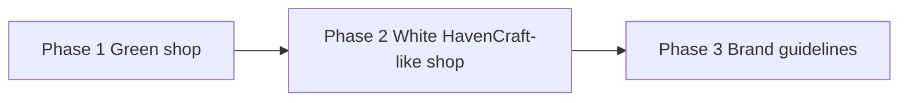
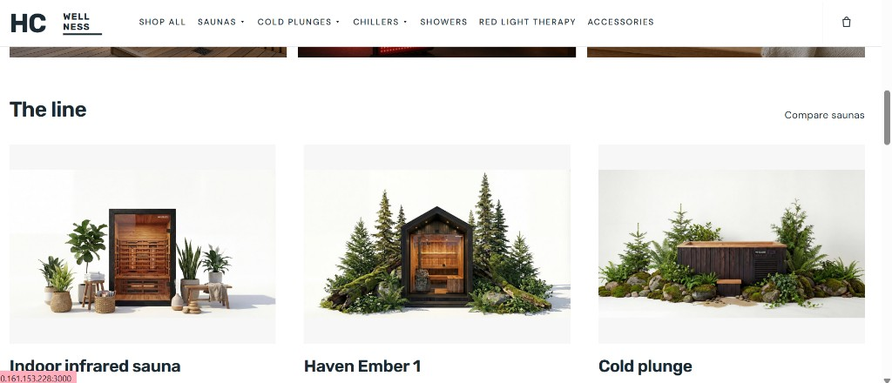
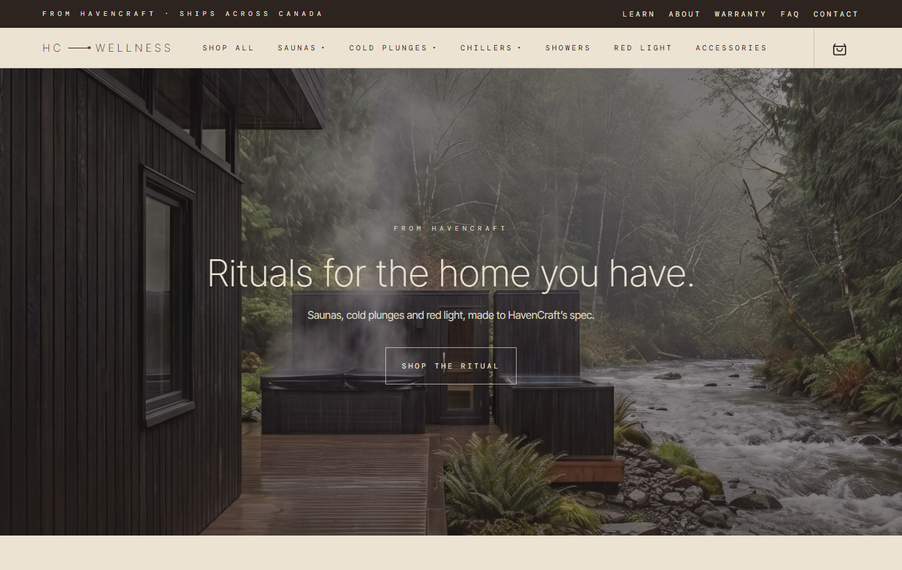
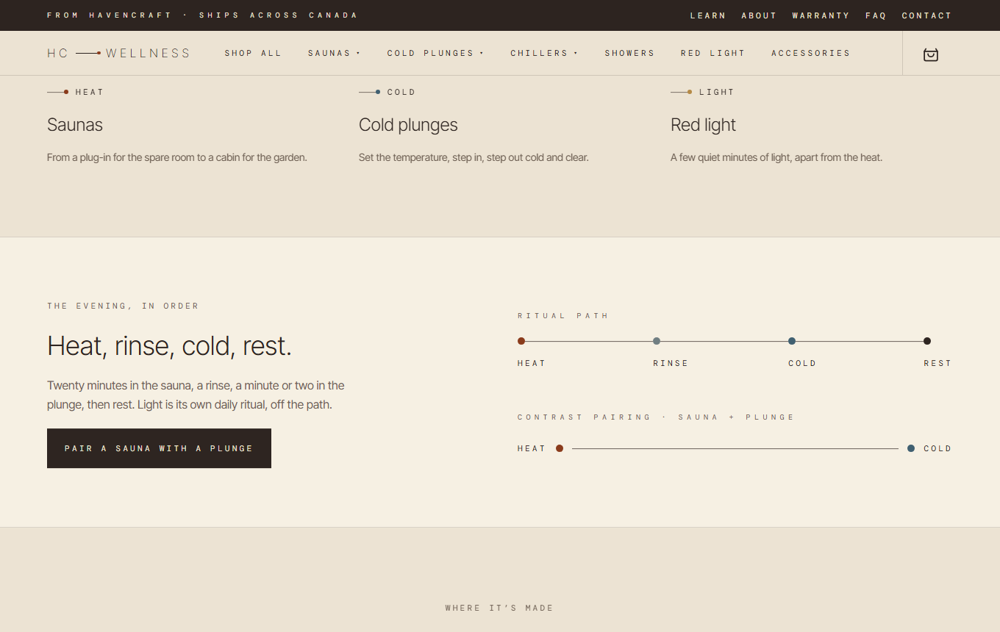
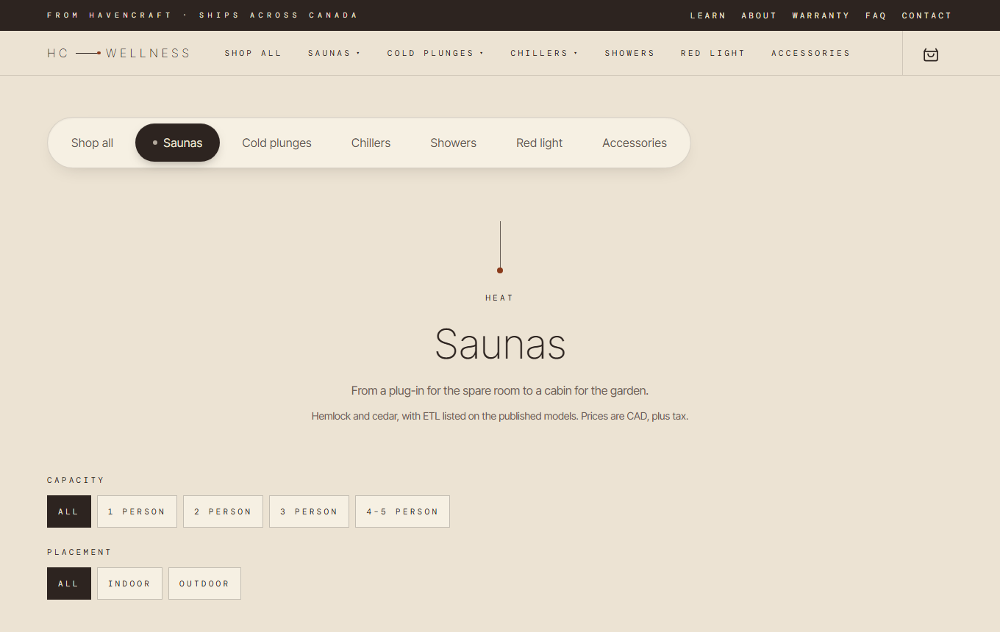
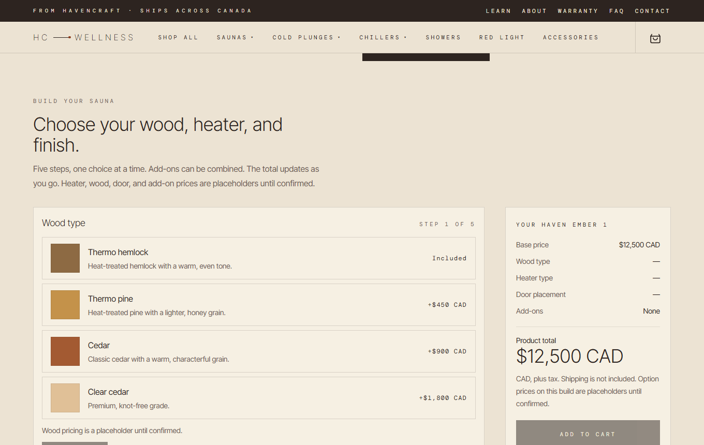
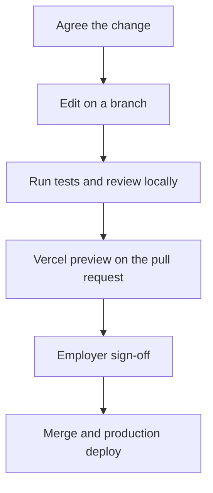
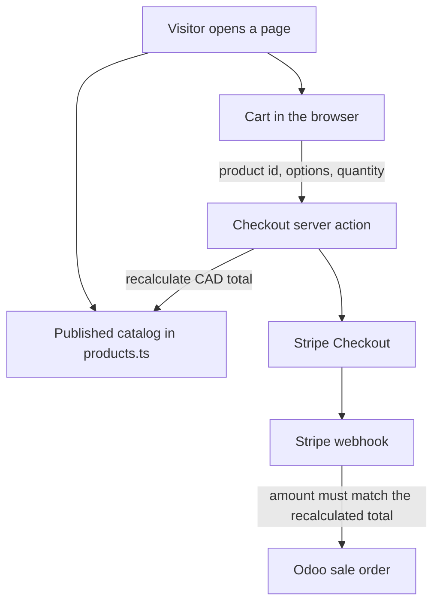
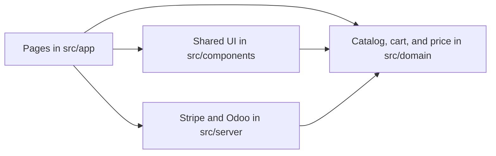

# HC Wellness

HC Wellness is HavenCraft’s wellness label for the home: saunas, cold plunges, and red light, at [hcwellness.ca](http://hcwellness.ca) (To be confirmed). This repository is the storefront. It presents the catalog, lets a visitor configure a sauna, holds a cart in the browser, and can hand a paid order to Stripe and then to Odoo once those credentials are set.

The look follows **HC Wellness Brand Guidelines V1** (October 2026): a quiet editorial layout, the hairline-split logo, and the Linen and Bark palette. Keep new pages inside that standard. The brand guide PDF, sell sheet, and website notes stay on disk and are not in this repository. `havencraft-sauna-configurator-brief.md` is the build brief for this storefront.

## What a visitor can do today

| Area              | Route                                                                | Status                                                                                                     |
| ----------------- | -------------------------------------------------------------------- | ---------------------------------------------------------------------------------------------------------- |
| Homepage          | `/`                                                                  | Editorial landing page: hero, shop by ritual, ritual path, origin line, HavenCraft Step-Up Credit, contact |
| Shop              | `/shop`                                                              | Every published product, grouped by ritual                                                                 |
| Saunas            | `/saunas`, `/saunas/compare`, `/saunas/[slug]`                       | Published models, filters, comparison, and the outdoor sauna configurator                                  |
| Cold plunges      | `/cold-plunges`, `/cold-plunges/[slug]`                              | Published plunge. Lake colour owns these pages                                                             |
| Chillers          | `/chillers`                                                          | Explains that the chiller ships with the plunge. It is not a separate priced product                       |
| Showers           | `/showers`, `/showers/[slug]`                                        | Placeholder collection. Names and prices are not confirmed                                                 |
| Red light         | `/red-light`, `/red-light/[slug]`                                    | Placeholder panels, mat, and mask. Names, specs, and prices are not confirmed                              |
| Accessories       | `/accessories`                                                       | The kit included with a sauna. Add-ons are chosen on the sauna page                                        |
| Learn             | `/learn`, `/learn/materials`, `/learn/benefits`, `/learn/safety-emf` | Materials, the ritual, and the published EMF note                                                          |
| Company           | `/about`, `/warranty`, `/faq`, `/contact`                            | About uses the endorsed logo. Contact opens the visitor’s email app                                        |
| Cart and checkout | `/cart`, `/checkout`                                                 | Cart is priced from the catalog. Checkout does not collect a card until Stripe is configured               |

Copy describes the ritual, the spec, and the warranty. It does not claim a medical outcome. Red light pages stay on that rule until Health Canada licences are confirmed.

## Phases

The shop was rebuilt twice. Each phase replaced the look of the one before it. The code in this repository is Phase 3. Phases 1 and 2 are no longer in the source.



### Phase 1 — Green shop

The first storefront. A basic shop in HavenCraft’s green: a forest-moss header and footer, a cream page, and ember buttons. It established the catalog, the cart, and the checkout path. That palette is gone from the code. A screenshot of it was not kept.

### Phase 2 — White, in the HavenCraft manner

The same shop, moved onto a white page so it would sit next to HavenCraft. A dark bar carried “The wellness line of HavenCraft Living.” The wordmark was a stacked HC over WELLNESS. Prices and the main button used a teal accent. The page structure, the product line, and the configurator were already the ones Phase 3 still uses.



### Phase 3 — Brand Guidelines V1

This is the current site, and the one a developer edits. It follows HC Wellness Brand Guidelines V1: Linen and Bark, the hairline-split logo, Inter Tight and DM Mono, and the temperature line. The catalog, configurator, cart, and checkout path carry forward from the earlier phases.

The screenshots below are Phase 3, November 2026. Files are in `docs/screenshots/`.

Homepage. Centred hero, one call to action, Linen type over the photograph.



Shop by ritual, then the ritual path: heat, rinse, cold, rest. Light stays off that path.



Saunas collection. Type-only header, the heat line, then capacity and placement filters.



Haven Ember 1 configurator. Wood, heater type, heater model, door, and add-ons, with the total updating beside the choices. Option prices on screen are still placeholders.



What is already in place:

- Pages, navigation, cart, and product routes listed above
- Sauna configurator with a live total, and a cart line that stores every choice
- Server-side price check before any payment
- Stripe Checkout and the Odoo order sink, both idle until their environment variables are set
- Brand guidelines applied: logo, palette, type, temperature line, and the origin line

What is still open on Phase 3. None of these need another visual rebuild. Each one is a content, credential, or confirmation change:

- Replace every placeholder product name, price, and spec. Showers and red light are marked placeholder on purpose.
- Confirm sauna woods, heaters, doors, add-ons, and their CAD deltas. Current option prices are labelled placeholder.
- Confirm warranty and delivery terms, then update `/warranty` and the product spec blocks.
- Set the HavenCraft Step-Up Credit terms. The homepage says the terms are still being set.
- Confirm Health Canada licensing before any red light sentence that claims a treatment, a healing effect, or a skin result.
- Commission photography. Current images are mood and product stand-ins.
- Drop in official logo files if HavenCraft supplies them.
- Claim the HC Wellness Instagram handle. The site currently points people to [@havencraft.living](https://instagram.com/havencraft.living).
- Connect Stripe with live keys, the production site URL, and the webhook signing secret.
- Confirm the Odoo mapping with HavenCraft before setting `ODOO_URL`, `ODOO_DB`, and `ODOO_API_KEY`. The field names and user id in `src/server/orders/odoo-mapper.ts` are a draft. Leave the variables empty until that confirmation exists.

Phase 3 is ready to take a live order when a real configuration can be paid for on the production domain and the matching order appears in Odoo.

## Later work

These are not further visual phases. They wait until Phase 3 is selling.

**A 3D builder.** A separate drag-and-drop tool for placing a sauna. It is not part of this app, and it does not block the shop opening. `three` and `@react-three/fiber` are installed and no page imports them. Keep that work from changing the catalog price rules in `src/domain`.

**A shared catalog in Odoo.** HavenCraft already sells through Shopify, with Odoo as the system the team works from. A later step can make this storefront read products, prices, and stock from that same record instead of from `src/domain/catalog/products.ts`, so a price change is made once. That needs Michael to confirm how the existing Shopify connection is shaped. Until then, the catalog in this repository stays the source of truth. The same step would cover orders stored in the same shape as a Shopify order, provincial sales tax, a confirmation email, and links between havencraftliving.com and hcwellness.ca.

## How the work moves

Every change on Phase 3 follows the same loop. The employer reviews a preview before anything reaches the live domain.



1. Agree the change in writing: which page, which price, or which sentence. Placeholder copy stays labelled until the final text arrives.
2. The developer branches, edits the file named in [Edit it](#edit-it), and keeps the brand rules above.
3. `npm test` passes, and the changed pages are checked in the browser, including a phone-width window when the layout moved.
4. The pull request builds a Vercel preview. That URL is the review link. It uses test Stripe keys, never live keys.
5. After sign-off, merge. Vercel deploys production from the main branch.
6. For a payment or order change, run one real test purchase on Stripe test mode and confirm the webhook and the Odoo record before switching to live keys.

## How the site works

Prices are never trusted from the browser. The cart stores a product id, the chosen options, and a quantity. The server looks those up in the catalog and computes the total again before it will start a payment or record an order.



With no environment variables, the shop still runs. Checkout explains that payment is not connected, and it does not collect or charge a card. Odoo is contacted only after Stripe reports a completed payment and the paid amount matches the catalog total.



`src/domain` has no React or Next.js imports. That is deliberate: pricing and cart rules can be tested without rendering a page. `src/server` is the only place that talks to Stripe or Odoo.

## Stack

- [Next.js 16](https://nextjs.org/docs) App Router, React 19, TypeScript
- Tailwind CSS 4, with brand tokens in `src/app/globals.css`
- [Framer Motion](https://www.framer.com/motion/) for small transitions. Motion is skipped when the visitor prefers reduced motion
- Vitest for catalog, cart, checkout, and payment tests
- Stripe Checkout and an Odoo JSON-RPC order sink, both optional

Node.js 20 or newer, and npm, are required. `three` and `@react-three/fiber` are installed for a later 3D configurator. No page imports them yet.

## Repository map

```
src/app                  routes, the root layout, and global CSS
src/components/brand     logo and the temperature line
src/components/layout    header, footer, navigation
src/components/product   cards, product page, sauna configurator
src/components/cart      cart state, drawer, cart page view
src/components/checkout  checkout form
src/domain/catalog       product records, price calculation, filters
src/domain/cart          cart line shape
src/server/checkout      revalidation of a submitted cart
src/server/payments      Stripe Checkout and the webhook
src/server/orders        Odoo order sink
public/images            photography used by the pages
docs                     architecture, catalog editing, Stripe and Odoo
```

Deeper notes:

- [docs/architecture.md](docs/architecture.md) — catalog, cart, `PaymentProvider`, and `OrderSink`
- [docs/catalog.md](docs/catalog.md) — how to add a model or an option. The live records are in `src/domain/catalog/products.ts`, which is the source of truth if the two disagree
- [docs/integrations.md](docs/integrations.md) — Stripe Checkout, the webhook, and the Odoo payload

## Brand rules for anyone editing the site

The guidelines are the design system. New pages should look like the pages already here.

| Token          | Hex       | Use                                                         |
| -------------- | --------- | ----------------------------------------------------------- |
| Linen          | `#ECE3D3` | Page ground                                                 |
| Bark           | `#2D2420` | Text, buttons, footer, dark bands                           |
| Clay           | `#8A3A1A` | The logo dot, and at most one accent word or link in a view |
| Ochre          | `#B58A45` | Block colour, and the Light ritual dot. Not for body text   |
| Cedar          | `#5C3F2C` | Block colour, including the Step-Up Credit band             |
| Slate Tile     | `#6F7D82` | Showers only                                                |
| Lake           | `#3F5F70` | Cold plunges and chillers only                              |
| Clay, reversed | `#D07E58` | Logo dot on Bark or Cedar                                   |

Type is loaded in `src/app/layout.tsx`:

- **Inter Tight** for everything a person reads. Display is ExtraLight (200). Headlines are Light (300). Body is Regular (400), 16px on a 26px line. Nothing heavier than 400.
- **DM Mono** for small uppercase labels: navigation, buttons, eyebrows, and prices on labels. Use the `type-label` and `type-micro` classes.

The logo is `BrandLogo` in `src/components/brand/brand-logo.tsx`. Use that component. Do not retype the wordmark, change its spacing, put it in a box, or recolour the hairline. `reversed` is for Bark and Cedar. `endorsed` adds “From HavenCraft” and belongs on About and first-meeting surfaces. The favicon is the HC mark in `src/app/icon.svg`.

The temperature line is `src/components/brand/temperature-line.tsx`. Heat is saunas, Light is red light, Rinse is showers, Cold is plunges. The word always sits beside the dot.

Voice is calm, direct, and in sentence case. The origin line, used wherever origin is stated, is: “Made to HavenCraft’s spec. Inspected, warrantied and supported by our team in Canada.” Do not write “Canadian”, “designed in Canada”, or “engineered in Canada” on the products.

## Run it locally

From the repository root:

```bash
npm install
npm run dev
```

Open [http://localhost:3000](http://localhost:3000).

| Command         | What it does                                           |
| --------------- | ------------------------------------------------------ |
| `npm run dev`   | Development server with hot reload                     |
| `npm run build` | Production build, including the TypeScript check       |
| `npm start`     | Serves the production build. Run `npm run build` first |
| `npm test`      | Runs the Vitest suite once                             |
| `npm run lint`  | ESLint                                                 |

Stop `npm run dev` before `npm run build`. The dev server writes into `.next` while the build is reading it, and the type check can fail on a half-written file.

Checkout works without credentials. Copy `.env.example` to `.env.local` only when you have Stripe or Odoo values to try. `.env.local` is gitignored. Never commit it.

```bash
# .env.local
STRIPE_SECRET_KEY=
STRIPE_WEBHOOK_SECRET=
NEXT_PUBLIC_SITE_URL=http://localhost:3000
ODOO_URL=
ODOO_DB=
ODOO_API_KEY=
```

A local Stripe webhook needs the [Stripe CLI](https://docs.stripe.com/stripe-cli) forwarding to `http://localhost:3000/api/stripe/webhook`. The signing secret from that forward is `STRIPE_WEBHOOK_SECRET`.

## Edit it

Work on a branch, run `npm test`, and look at the changed pages in the browser before opening a pull request.

**Change words on a page.** Each route is a `page.tsx` under `src/app`. The homepage is `src/app/page.tsx`. Shared sentences such as the footer origin line live in `src/components/layout/site-footer.tsx`.

**Change navigation or the contact card.** `src/components/layout/site-nav.ts` holds the shop menus, the utility links, and the name, email, and phone shown on the site.

**Add or change a product.** Edit the catalog array in `src/domain/catalog/products.ts`. The shape is `Product` in `src/domain/catalog/types.ts`. A published product needs a stable `id` and `slug`, a `category` of `sauna`, `cold-plunge`, `shower`, or `red-light`, `visibility: "published"`, integer `priceCadCents` and `listPriceUsdCents`, and `specs`, `includes`, and `optionGroups`. CAD cents are what the cart charges. The USD figure is the printed list price and is not added into the cart. Hidden records, including Ember 2, are omitted from listings, product pages, and checkout. Set `placeholder: true` while the name or spec is still unconfirmed so the page says so.

Product URLs are `/{collection}/{slug}`: `/saunas/ember-1`, `/cold-plunges/cold-plunge`, `/showers/...`, `/red-light/...`.

**Change sauna options.** Wood, heater, door, and add-on choices live in `src/domain/catalog/sauna-options.ts` and are attached to the sauna records. The configurator in `src/components/product/product-configurator.tsx` renders whatever groups the product has. `calculatePrice` in `src/domain/catalog/price.ts` is the only total: it rejects an unknown product, a missing choice, or an option the product does not have. Add a test next to the existing ones in `src/domain/catalog/price.test.ts` when the price rules change.

**Change colours or type.** Tokens are in `src/app/globals.css`. Fonts are in `src/app/layout.tsx`. Buttons and selected pills are in `src/components/ui/styles.ts`. Prefer the existing tokens over a new hex value.

**Replace a photograph.** Put the file in `public/images` and point the page or the product’s `imageSrc` at `/images/...`. The guidelines ask for real rooms, warm grade, and no product cut out on white. Several current images are stand-ins.

**Replace the logo.** If official logo files arrive, use those files and retire the drawn `BrandLogo` paths. Keep the clear space, the Clay dot, and the minimum width from the guidelines.

## Deploy on Vercel

The app is a standard Next.js project. [Vercel](https://vercel.com) detects that and builds it with `npm run build`.

1. Push this repository to GitHub.
2. In Vercel, choose **Add New Project** and import the repository. Leave the framework preset on Next.js. The install, build, and output settings can stay on their defaults.
3. Add environment variables in the project settings before relying on checkout. Use the same names as `.env.example`. Set `NEXT_PUBLIC_SITE_URL` to the public origin, for example `https://hcwellness.ca`, with no trailing path.
4. Deploy. Vercel gives the project a `*.vercel.app` address immediately. Attach the production domain in **Settings → Domains** and follow the DNS records Vercel shows.
5. After the production URL is final, set `NEXT_PUBLIC_SITE_URL` to that origin and redeploy so Stripe’s success and cancel URLs match it.
6. In the Stripe dashboard, add a webhook endpoint at `https://<your-domain>/api/stripe/webhook` for `checkout.session.completed`. Put that endpoint’s signing secret in `STRIPE_WEBHOOK_SECRET` and redeploy.

Preview deployments on pull requests are useful for review. Give them test Stripe keys, not live keys. Do not put secrets in the repository or in `NEXT_PUBLIC_` variables other than the site URL. `NEXT_PUBLIC_SITE_URL` is visible to the browser because Stripe needs it for return URLs.

`npm start` is only for running the production build on your own machine or another Node host. Vercel runs the build itself. The remaining launch items are listed under [Phase 3](#phase-3--brand-guidelines-v1).
