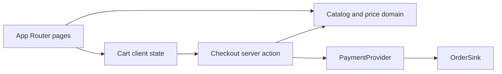

# Architecture

HC Wellness is a Next.js App Router storefront. Pages live under `src/app`. Shared UI lives under `src/components`. Catalog and cart math live in `src/domain` and do not import React or Next. Stripe and Odoo are ports under `src/server`, selected from environment variables in one place.

Shopify is out of scope. The 3D builder is phase 2 and is not in this app.

## Catalog domain

Types are in `src/domain/catalog/types.ts`. The sell-sheet records are the frozen array in `src/domain/catalog/products.ts`.

Published reads (`listPublishedProducts`, `listPublishedSaunas`, `listPublishedColdPlunges`, `listSaunasForComparison`, `getPublishedProductBySlug`, `getPublishedProductById`, `filterSaunas`) omit `visibility: "hidden"`. Ember 2 is the hidden record. A hidden slug is not a product page.

`src/domain/catalog/price.ts` is the only total. `calculatePrice` looks up a published product and returns `priceCadCents` plus the selected option deltas. It rejects an unknown product, an unknown option, a missing group selection, or an extra group. There is no argument for a client-supplied total.

`src/domain/catalog/display.ts` formats capacity, placement, spec rows, and the product description from fields the record actually has. `src/domain/money.ts` formats integer cents for display. CAD is the cart currency. The USD figure is the printed list price and is not added into the cart.

## Cart

`CartProvider` in `src/components/cart/cart-provider.tsx` holds the cart in React context and mirrors it to `localStorage` under the key `hc-wellness-cart`.

Each line, defined in `src/domain/cart/cart.ts`, stores `productId`, `selections` (option group id to option id), and `quantity`. The stored JSON also has `version: 1`. Price is not stored. A client total on a submitted payload is ignored by `parseCartLines`.

The cart page and the product configurator call `calculatePrice` so the number on screen comes from the catalog. Checkout does not trust that number. `validateCart` in `src/server/checkout/validate-cart.ts` recomputes every line with `calculatePriceFromCatalog` against the published catalog, multiplies by quantity, and sums the lines. Hidden products are unknown. Quantity must be an integer from 1 through 99.

## PaymentProvider

`src/server/payments/types.ts` defines `PaymentProvider`: `configured` and `createCheckout`. `createPaymentProvider` in `src/server/payments/provider.ts` returns the Stripe implementation only when `STRIPE_SECRET_KEY` is set. Otherwise it returns `unconfiguredPaymentProvider`, which does not construct a Stripe client and resolves to `payments_not_configured`.

`prepareCheckout` in `src/server/checkout/prepare.ts` parses the cart, validates it, then asks the provider for a session. The checkout server action `startCheckout` redirects only when that session returns a URL.

## OrderSink

`src/server/orders/types.ts` defines `OrderSink`: `configured` and `recordPaidOrder`. `createOrderSink` in `src/server/orders/sink.ts` returns an Odoo JSON-RPC sink only when `ODOO_URL`, `ODOO_DB`, and `ODOO_API_KEY` are all set. Otherwise `recordPaidOrder` returns `orders_not_configured` and does not report that an order was recorded.

The webhook (`POST /api/stripe/webhook`) verifies the Stripe signature and calls the sink only when both Stripe webhook settings and Odoo are configured. See [integrations.md](integrations.md).
